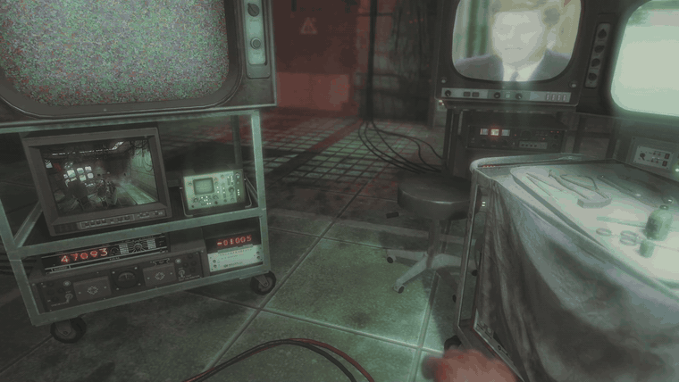

# BlackOps Terminal Bridge

Turn the easter-egg terminal hidden in the **Call of Duty: Black Ops (2010)** main
menu into a **real, working shell** — running inside the actual game process,
rendered by the game's own text renderer.

<p align="center">
  
  <br>
  <em>Walking up to the menu terminal, then a real shell: PowerShell, <code>ls</code> and <code>cd</code> over WSL, and ASCII art — all rendered by the game's own text renderer.</em>
</p>

The stock terminal is a hardcoded fake: a fixed command table, a scripted file
system, canned responses, plus the embedded Zork and Dead Ops Arcade games. It has
no I/O to the host at all. This project bolts a real host shell onto it entirely
from the outside — with no source, no symbols, and no debug information. You type
in the game; a real PowerShell runs on your PC; its output is painted back into the
in-game scrollback with correct font, colours and wrapping. It is a full terminal
emulator, so interactive programs work too: `ssh`, the Python REPL, `vim`, `htop`.

**[→ Architecture & reverse-engineering write-up](docs/ARCHITECTURE.md)**

## Features

- **Real shell inside the game** — opens PowerShell 7 by default, falling back to
  Windows PowerShell 5.1, then `cmd.exe`.
- **Full terminal emulator** — ConPTY backend + a VT/ANSI parser, so TUIs (vim,
  htop, Claude Code) render in-game.
- **8000-line scrollback** with mouse-wheel scrolling and a visual scrollbar
  (PgUp/PgDn too).
- **24-bit truecolor** text, bypassing the engine's 8-colour palette.
- **Latin-1 codepage** for accented characters and common symbols.
- Authentic **typewriter reveal** matching the native terminal, with an
  instant-mode toggle.
- Non-destructive: the normal terminal, menu, and games are untouched until you opt
  in.

## Requirements

- Windows 10/11 (x64).
- **Call of Duty: Black Ops (2010)** installed.
- **Visual Studio 2022** (Community edition is fine) with the *Desktop development
  with C++* workload. That is the only build dependency — CMake ships with VS, and
  MinHook is fetched automatically.

## Quick start

```powershell
# 1. Get the code
git clone https://github.com/mansekhon983/BlackOps-Terminal-Bridge.git
cd BlackOps-Terminal-Bridge

# 2. Build (32-bit, to match BlackOps.exe)
.\build.ps1

# 3. Launch Black Ops -- OFFLINE (see the safety note) -- and open the
#    easter-egg terminal in the main menu.

# 4. From an ELEVATED PowerShell, inject:
.\run.ps1

# 5. In the in-game terminal, type:  emu
```

You are now in a real shell. Press `Ctrl+]` to leave.

## In-game controls

| Key / word | Action |
|---|---|
| `emu` | Toggle the real-shell emulator on/off |
| `Ctrl+]` | Leave emu mode |
| `Ctrl+\` | Toggle the typewriter reveal (instant vs. animated) |
| Mouse wheel / `PgUp` / `PgDn` | Scroll the 8000-line history |
| Any keypress while scrolled | Snap back to the live bottom |

There is also a lighter `connect` line-mode that runs one command at a time through
the engine's own scrollback renderer, with no emulator. It was the first working
milestone and is kept as the simplest demonstration of the bridge, but it cannot
host interactive programs — which is why the emulator exists.

## How it works

An injected DLL (`bo1bridge.dll`, x86) inline-hooks the engine with
[MinHook](https://github.com/TsudaKageyu/minhook) at three points: the
command-submit handler, the per-frame terminal renderer, and the glyph-run drawer
(reused to paint our grid and to override its colour).

A [ConPTY](https://learn.microsoft.com/windows/console/pseudoconsoles) child process
runs the real shell. A reader thread feeds its output through a VT/ANSI parser into
a screen model with an 8000-line scrollback, which is blitted into the engine's own
character and attribute grids each frame. All engine calls happen on the main thread
via the frame hook — calling them from the worker thread crashes the game.

The interesting parts — how the renderer's shared vertex budget silently culls the
bottom rows, why run colour comes from the wrong cell, and how 24-bit colour gets
past an 8-slot palette — are in
**[docs/ARCHITECTURE.md](docs/ARCHITECTURE.md)**.

## ⚠️ Safety & scope

- **OFFLINE / SINGLE-PLAYER ONLY.** Black Ops multiplayer ran **VAC**; injecting a
  DLL into a VAC-secured session is a ban. The terminal is a menu/campaign feature —
  there is no reason to be online. **Turn networking off** before injecting.
- **This runs whatever you type as a host shell command, by design.** It is a
  personal, single-machine novelty. Do not expose it over a network. If you ever add
  an IPC/bridge channel, bind it to `localhost` only.
- `run.ps1` must run from an **elevated** shell (it uses `CreateRemoteThread`).
- Offsets are resolved at load time by signature/RVA against this specific build of
  the game; a game update can break them. See [`notes/offsets.md`](notes/offsets.md).

## Repository layout

```
src/              DLL: dllmain, hooks, ConPTY backend, VT parser, screen grid, sig-scan
tools/            inject.exe + offline harnesses (feed_log, conpty_test, vtparse_test)
notes/            offsets, RE log, plan; notes/dumps/ = raw Ghidra decompiler output
ghidra_scripts/   headless recon scripts used to find the offsets
docs/             ARCHITECTURE.md (overview) + report.tex (full typeset write-up)
build.ps1         configure + build (Win32)
run.ps1           inject into a running BlackOps.exe
```

## Building manually

```powershell
cmake -S . -B build -G "Visual Studio 17 2022" -A Win32
cmake --build build --config Release
```

Outputs: `build/Release/bo1bridge.dll` and `build/Release/inject.exe`. The
`-A Win32` is mandatory — a 64-bit DLL cannot load into the 32-bit game.

## Documentation

| Document | What it covers |
|---|---|
| [`docs/ARCHITECTURE.md`](docs/ARCHITECTURE.md) | Architecture, RE methodology, recovered engine surface, renderer internals, notable findings. **Start here.** |
| [`docs/report.tex`](docs/report.tex) | Full typeset write-up, including the complete error-and-fix log. |
| [`notes/offsets.md`](notes/offsets.md) | Curated table of confirmed addresses, signatures and calling conventions. |
| [`notes/re-log.md`](notes/re-log.md) | Chronological reverse-engineering log, session by session. |

## License

[MIT](LICENSE). A personal/novelty project provided as-is, for offline single-player
use. No warranty.
